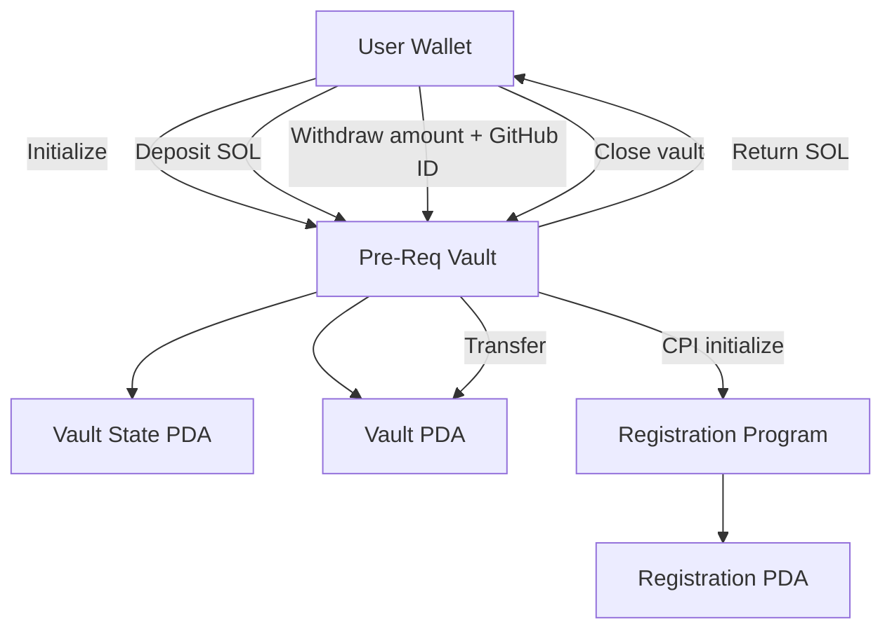

# Turbin3 Pre-Req Vault

An Anchor-based Solana vault program integrated with the Turbin3 prerequisite registration program through a Cross-Program Invocation (CPI).

## Features

- Initialize a vault and its state PDA.
- Deposit SOL into the vault.
- Withdraw SOL and invoke the registration program with a GitHub username.
- Close the vault and return remaining funds.

## Architecture



## Program IDs

- Vault program: `AEGC9t8vy86FTgzaxRLBcZWidSF1smZ1NNaL3cN8Zusa`
- Registration program: `TRBZyQHB3m68FGeVsqTK39Wm4xejadjVhP5MAZaKWDM`

## Requirements

Install Rust, Solana CLI, Anchor, Node.js and pnpm.

## Build

```bash
pnpm install
anchor build
```

## Tests

```bash
pnpm exec ts-mocha -p ./tsconfig.json -t 1000000 "tests/**/*.ts"
```

Check `Anchor.toml` before running tests to confirm the selected cluster and wallet.

## Testing Status

The withdrawal integration requires additional verification when the registration PDA already exists on Devnet. Repeated initialization can fail for an already initialized account. Do not consider the full integration suite verified until this case has been resolved and the tests pass.

## Security

- Never commit private keys or seed phrases.
- Use a disposable development wallet.
- Verify account constraints and program IDs before deployment.
